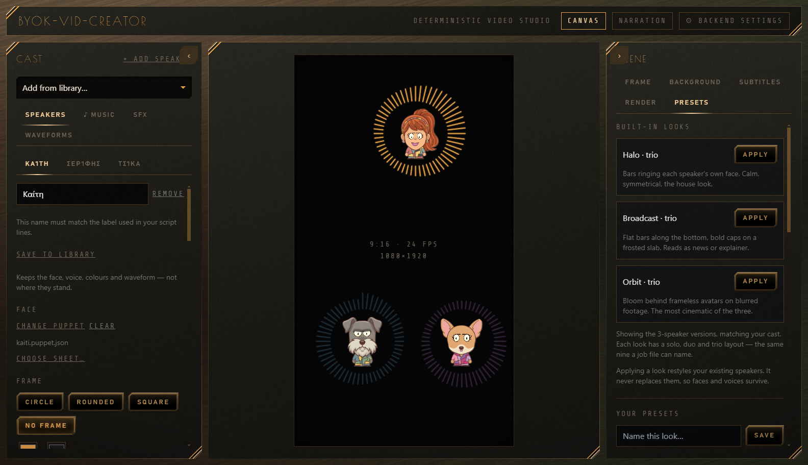

# Video Forge

Video Forge is the evolution of the app formerly called BYOK-Vid-Creator.

**Bring Your Own Keys. Build cinematic, talking-avatar videos — locally, deterministically, beautifully.**

<p align="center">
  <a href="#features">Features</a> ·
  <a href="#quick-start">Quick Start</a> ·
  <a href="#roadmap">Roadmap</a>
</p>

---

## What is this?

Video Forge is a **desktop studio** for producing narrated, subtitled,
avatar-driven videos with animated audio waveforms — in Greek and English.

It is **not** a generative-video toy. Every frame is **deterministic**:
what you arrange on the canvas is exactly what renders. You bring your own
API keys for TTS and stock media; everything runs and renders **on your
machine** via a bundled Remotion + FFmpeg pipeline.

> Designed for creators who want **repeatable, polished output** — not
> a slot machine.

## ✨ Features

- 🎙️ **Two voice engines.** **DramaBox** acts — stage directions in the script
  control the performance and never appear in the audio — and runs on a rented
  GPU. **Piper** runs locally: correct, flat, and fast enough to check timing.
- 🎚️ **Every voice knob, per character and per line.** Acting, pace, obedience
  and ten more, on sliders. A `[VOICE: acting=2.4]` line in the script overrides
  them for one block.
- 👄 **Viseme lip-sync** — 9-shape mouth animation, driven by forced alignment
  against the script rather than an estimate
- 🧑‍🤝‍🧑 **Puppets with live faces** — pick from the Cast "+" menu (ready-made, made in Image Forge, or your library); they blink, talk, nod and gesture on their own (question = shrug, "this/here" = point), with a "How much they gesture" slider
- 👄 **Smoother mouths** — shapes held ~100 ms, look-alikes merged in fast speech, half-open in-betweens
- 📝 **Subtitle engine** — word-level timing, active-word glow, `.srt` and `.vtt` files beside every video
- 📐 **One script, every shape** — Make → Also as: Tall 9:16, Square 1:1, Portrait 4:5, Wide 16:9
- 🌍 **Twin language video** — Also in English/Greek: script translated, same cast, matching subtitles
- 🏷️ **Honest AI label** — "Made with AI · Video Forge" on the picture (on by default) and in the file's notes
- 🔤 **Greek stress fixer** — adds missing accents before the voice speaks; a "Say it like this" list for stubborn words
- 📊 **Many videos from a sheet** — a Google Sheet link or CSV, one row per video, made one after another into a folder named `<sheet> · <date> · <n> videos`
- 💬 **Hover help on every control**
- 🌊 **6 waveform styles** × 5 positions × 6 behavior modes (only active speakers animate)
- 🎼 **Smart audio** — auto-ducking, Freesound/Pixabay library, pinned custom uploads
- 🎞️ **AI background automation** — contextual stock clips with a Relevancy↔Frequency dial
- 🖥️ **Local rendering** — Remotion + FFmpeg, up to 10-min videos, 9:16 & 16:9
- 🎛️ **Tactile UI** — charcoal-metal chassis, chunky clear-plastic controls, amber glow

## 🚀 Quick Start

```bash
git clone https://github.com/DnD-World/Video-Forge.git
cd Video-Forge
npm install
npm run dev
```

> Open the Backend Panel → paste your API keys → add a speaker, give them a puppet and a script → hit Render.
> The app ships with no characters of its own. Make your own ([docs/PUPPET-MAKING.md](docs/PUPPET-MAKING.md)),
> or switch on a brand pack — a creator's cast, sample project and clips — with `npm run brand -- <name>`
> ([docs/BRAND-PACKS.md](docs/BRAND-PACKS.md)).
> Recommended specs: NVIDIA 8GB GPU · 32GB RAM · ~1 hr render / 10 min video.

## Guides
- [Make a video, in plain words](docs/eli5/make-a-video.md)
- [Writing scripts](docs/WRITING-SCRIPTS.md) · [Making puppets](docs/PUPPET-MAKING.md) · [Install](docs/INSTALL.md)
- [Handoff (current state)](docs/HANDOFF.md) · [Changelog](CHANGELOG.md)

## 🗺️ Roadmap
- Template gallery: lesson, news desk, podcast, promo
- Interface in Greek, French, German, Spanish and Portuguese (Settings → Language shows them as coming soon)
- Rendering a series in one process, instead of paying browser startup per video
- Expanded transition library

**Not on the roadmap, decided:** Azure Speech, Edge TTS and
Chatterbox. Every extra engine multiplies what can break, and DramaBox plus
Piper cover expressive and fast. Chatterbox shipped and was removed in
August 2026.

## 🤖 Built With AI
This project was designed and engineered in collaboration with AI systems:
- You.com — orchestration & research
- Anthropic Claude Opus 4.8 — architecture, code generation, lip-sync design
- Hermes Agent — automation
- Google Flow — media workflow support
- Human direction & product vision: Stravelakis.
## 📄 License
TBD.
